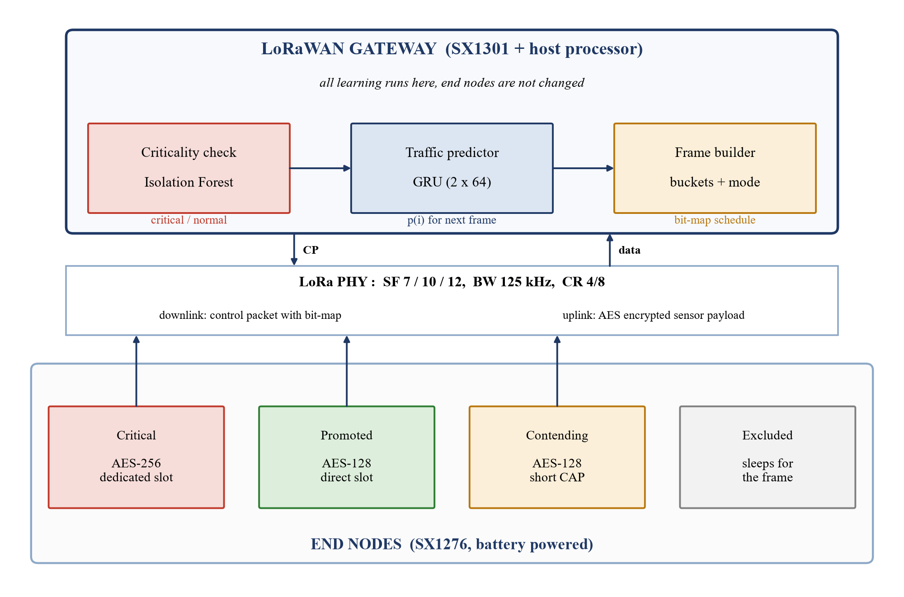
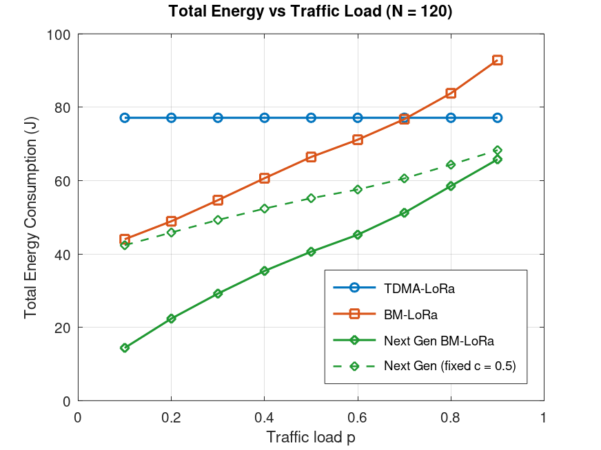
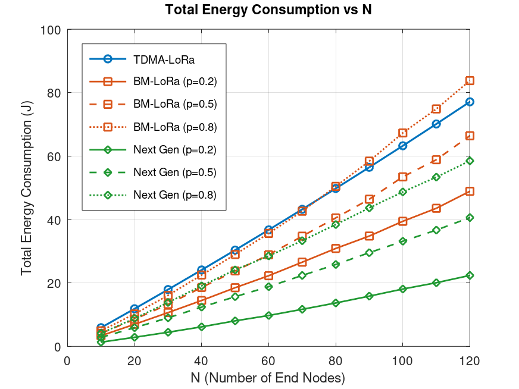
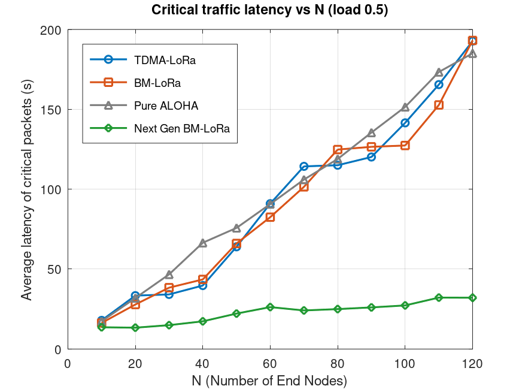

# Next Gen BM-LoRa

An Adaptive Machine Learning Based Bit-Mapping MAC Protocol for Energy-Efficient and Secure LoRaWAN

Major Project-1 (15B19EC791), B.Tech ECE, Semester 7, JIIT Noida

Supervisor: Dr. Manoj Tolani
Team: Vansh Ahuja (23102128), Saksham Kuksal (23102129), Prem Aggarwal (23102132)

## Report

Full project report (100 pages): [report/Major_Project_Report_Next_Gen_BM_LoRa.pdf](report/Major_Project_Report_Next_Gen_BM_LoRa.pdf) (Word version in the same folder).



## About

Base paper: K. T. Vikash, G. Suman, M. Tolani, A. T. Tumunuri and P. Kumar, "Bit-Mapping Based Security-Aware Energy-Efficient MAC Protocol for LoRaWAN", IEEE Access, vol. 13, pp. 52497-52507, 2025.

In BM-LoRa the event probability p and the critical fraction c are fixed (0.5) and the contention access period (CAP) is present in every frame. Because of this, plain TDMA uses less energy than BM-LoRa when traffic is high (the base paper reports this itself).

In our protocol the gateway does three things before it builds every frame:

1. An Isolation Forest checks the latest reading of every node and marks the node critical (AES-256, dedicated slot) or normal (AES-128).
2. A GRU predicts the probability that each normal node will have data in the next frame.
3. Normal nodes are put in three buckets (promoted / contending / excluded) using two thresholds (0.3 and 0.7), and the gateway picks the frame type (BM, hybrid or TDMA) that gives the lowest estimated energy.

The base paper energy model (Eq. 1-17, Table 3) is used for all protocols.

## Folders

```
data/       dataset and files made by python (data/sim is used by matlab)
python/     data preparation and machine learning
matlab/     energy model of base paper and simulation of all protocols
results/    base_paper/ (replication), ml/ (model results), nextgen/ (final results), tests/ (test case logs)
report/     project report (pdf, docx) and the diagrams used in it
```

## How to run

Python 3 with the packages in `python/requirements.txt`.

```
cd python
python prepare_data.py        # cleans data, 10 min frames, traffic for load 0.1 - 0.9
python criticality_model.py   # isolation forest vs fixed threshold
python traffic_predictor.py   # GRU + persistence, ARIMA, random forest (takes ~9 min on CPU)
```

MATLAB R2024b (we also ran everything in GNU Octave 11). Open the `matlab` folder and run:

```
base_paper_results   % Fig 5-13 of the base paper
check_model          % frame simulator vs base paper equations
run_nextgen          % all results of our protocol (~3 min)
compare_base_paper   % Fig 5-7 of the base paper with our protocol added
```

Test cases (section 4.3 of the report). Run them after the steps above:

```
test_cases                   % matlab folder, TC1-TC12: energy model and frame logic
python check_outputs.py      # python folder, TC13-TC19: files made by the python scripts
```

All 19 pass. The console output of both is in `results/tests/`.

## Dataset

Intel Berkeley Research Lab data (54 Mica2Dot motes, temperature, humidity, light and voltage every 31 s).
http://db.csail.mit.edu/labdata/labdata.html

We used 28 Feb 2004 01:00 to 10 Mar 2004 01:00 (11 days) because after that many motes start dying. Mote 15 was removed (only 21 % data), so 51 motes are used. Readings are averaged into 10 minute frames (1584 frames), first 70 % for training and last 30 % (476 frames) for testing.

- Traffic: a node has data in a frame when its reading changed (send on change). The change score is the largest of |dT|, |dH|, |dLight| after dividing each by its 90th percentile. For load p the threshold is the (1-p) quantile of the train scores, so we get 9 traffic loads (0.1 to 0.9).
- Critical: a reading is unusual when it is outside the normal range of that node. There are no labels in the dataset so reference labels are made with the 3 sigma rule (median and MAD of each node).
- For more than 51 nodes, extra nodes are the real motes with a random time shift.

## Values not given in the base paper

| Parameter | Value | Reason |
|---|---|---|
| Guard time Tg | 1 symbol | TDMA gateway energy then matches the paper for SF 12, 10 and 7 |
| CAP subslot | 2 symbols (request + guard) | gives the high traffic crossover of BM-LoRa like the paper |
| Duty cycle, Ncycles | 10 %, 20 | TDMA total energy matches Fig 7 (77.1 J vs 77.2 J) |
| Control packet | preamble + 1 byte | Eq. 2 |
| AES energy | 2.5 uJ per 16 byte block, AES-256 22.8 % more | base paper says the difference is a few uJ (ref. Munoz et al.) |

Energy is in Joule. The base paper writes uJ on the y-axis but with Table 3 values the numbers come in J.

## Notes on the replication of the base paper

- TDMA-LoRa matches the paper very closely (SF 12: gateway 18.1, end node 59.0, total 77.1 J; paper 18.0, 59.2, 77.2).
- BM-LoRa follows the same trend: better than TDMA at p = 0.2 and 0.5, worse at p = 0.8 for large N (from N = 60 in our case, around N = 90 in the paper).
- With the equations as printed, BM-LoRa saves 36.5 % at N = 120, p = 0.2. The paper reports more than 70 %. With c = 0.5 half of the nodes transmit in every frame, so the saving from Eq. 11-12 cannot go above about 50 %.
- Eq. 11 is written with Nn but Fig. 4 of the paper only has Nn1 normal slots, so we used Nn1. Eq. 14 has (Td + Td), we used (Td + Tg).
- `check_model.m` shows our frame simulator gives the same energy as Eq. 7-14 (within 0.3 %).

## Results (SF 12, payload 50 bytes)

Traffic prediction on test data (all loads):

| Model | Accuracy | RMSE | FNR |
|---|---|---|---|
| Persistence | 85.3 % | 0.384 | 0.159 |
| ARIMA(2,0,0) | 85.5 % | 0.328 | 0.140 |
| Random Forest | 86.6 % | 0.312 | 0.126 |
| GRU (2 x 64) | 86.5 % | 0.311 | 0.124 |

Criticality (test data): Isolation Forest F1 = 0.47 (precision 0.41, recall 0.55), fixed threshold F1 = 0.32.

Total energy at N = 120 (J):

| Load | TDMA-LoRa | BM-LoRa | Pure ALOHA | Next Gen | Next Gen with c = 0.5 |
|---|---|---|---|---|---|
| 0.2 | 77.10 | 48.90 | 29.06 | 22.36 | 45.83 |
| 0.5 | 77.10 | 66.41 | 42.03 | 40.60 | 55.18 |
| 0.8 | 77.10 | 83.78 | 55.19 | 58.50 | 64.32 |

- BM-LoRa uses more energy than TDMA from load 0.8. Next Gen stays below both TDMA and BM-LoRa at every load (0.1 to 0.9) and every N.
- With the same fixed critical nodes as the base paper (c = 0.5) Next Gen still stays below both, so the crossover is removed by the prediction and frame selection alone. The extra saving in the main result comes from dynamic criticality (about 3.5 % of readings are critical instead of 50 % of nodes).
- Savings vs BM-LoRa at load 0.5 are almost the same for SF 12/10/7 (38.9 / 38.4 / 37.6 %) and payload 50/80/100 (38.9 / 38.0 / 37.6 %).
- Average latency of critical packets at N = 120, load 0.5: TDMA 192.7 s, BM-LoRa 193.1 s, ALOHA 185.0 s, Next Gen 32.1 s.
- PDR is 100 % for the scheduled protocols. Pure ALOHA delivers only 27-38 % because of collisions (no retransmission). ALOHA uses less energy than Next Gen at high load but loses most of its packets.
- Network lifetime (first node death) relative to TDMA at load 0.5: Next Gen 1.47-1.51, BM-LoRa 0.81-1.06, ALOHA 1.70-1.80.
- AES-256 for critical nodes adds 22 uJ out of 40.6 J (0.00005 %).
- Break-even accuracy (Eq. model with prediction error, N = 120): 0.84 at p = 0.1, 0.44 at p = 0.2, 0.14 at p = 0.3 and below that for higher load. GRU accuracy is above it at all loads.

Main graphs:







All other graphs are in `results/base_paper/`, `results/ml/` and `results/nextgen/`. The full console output of the last run is in `results/nextgen/run_log.txt`.

## Limitations

- The BM frame was never chosen by the gateway. The hybrid frame already becomes the BM frame when all normal nodes are contending, and the shorter CAP made hybrid cheaper every time. TDMA frames were chosen in 2-46 % of frames (more at high load).
- Persistence gives lower energy than GRU (35.5 vs 40.6 J at load 0.5) because it never sends nodes to the CAP, but it misses 3 times more packets (FNR 0.112 vs 0.044) and average delay is higher (143.5 vs 128.2 s).
- GRU and Random Forest are almost the same on this data.
- Criticality labels are made by us (3 sigma rule) because the dataset has none.
- Single gateway, no mobility, no capture effect, simulation only (same as base paper).
